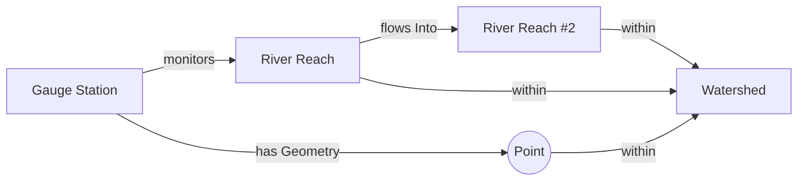
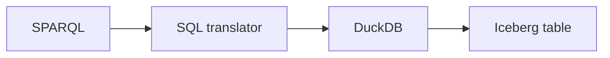

<GraphMotif />

# Reproducible Geospatial Knowledge Graphs with Apache Iceberg

### Lessons from building <a href="https://github.com/cgs-earth/sal" target="_blank">SAL</a>, the Semantic Accessibility Layer

<div class="mt-12 text-lg opacity-95">
Colton Loftus · Center for Geospatial Solutions (CGS) Lincoln Institute of Land Policy
</div>


<!--
Open on who I am, then the one-sentence hook: we built a linked-data / SPARQL
graph without running a triple store — it lives as an Iceberg table. That's
the whole talk.
-->

---

# About me

<div class="about mt-2">

<div class="about-id">
<div class="about-photo">

</div>
<div class="about-name">Colton Loftus</div>
</div>

<div>

<div class="feature-list solo">

<div class="feature-row">
<div class="icon-badge"><carbon:laptop /></div>
<div>
<h3>Software engineer at the Lincoln Institute of Land Policy</h3>
<p>Data engineering at the Center for Geospatial Solutions, often for hydrology and geoscience.</p>
</div>
</div>

<div class="feature-row">
<div class="icon-badge"><carbon:code /></div>
<div>
<h3>Open-source committer</h3>
<div class="go-box">
<span class="go-box-label">Go implementations</span>
<div class="about-tags">
<span>Iceberg</span>
<span>Arrow</span>
<span>Parquet</span>
<span>GeoArrow</span>
</div>
</div>
</div>
</div>

<div class="feature-row">
<div class="icon-badge"><carbon:partnership /></div>
<div>
<h3>Building with federal &amp; international agencies</h3>
<div class="about-logos">

<span class="agency-mark wmo">WMO</span>
<span class="agency-mark usbr">Reclamation</span>
<span class="more">and more</span>
</div>
</div>
</div>

</div>
</div>

</div>

<!--
Keep this to thirty seconds. The committer work is why SAL is built on
Iceberg and Arrow in Go; the agency work is where the real-world data and
requirements come from.
-->

---

# Teams often face 3 challenges when sharing geospatial open data

<div class="feature-list solo mt-8">

<div class="feature-row">
<div class="icon-badge"><carbon:money /></div>
<div>
<h3>Budget to host data long term</h3>
</div>
</div>

<div class="feature-row">
<div class="icon-badge"><carbon:compare /></div>
<div>
<h3>Semantic definitions for properly integrating data</h3>
</div>
</div>

<div class="feature-row">
<div class="icon-badge"><carbon:fingerprint-recognition /></div>
<div>
<h3>Tracking provenance and edits, both of the data and the source code that produced it</h3>
</div>
</div>

</div>

---

# Geospatial data often models well as a graph

<p class="text-xl -mt-1" style="color: var(--cgs-pavement); opacity: 0.7">Many systems have thousands of properties and spatial relationships connecting places.<br />Joins in a traditional database can become cumbersome.</p>

<div class="mt-10 flex justify-center">



</div>

<!--
Set up the intuition. A gauge monitors a reach, the reach flows into another
reach, sits within a watershed. That's a graph — geometry is just another edge.
-->

---

# Graph databases can have advantages over relational databases for geospatial data

<div class="grid grid-cols-3 gap-6 mt-14">

<div class="card">
<div class="icon-badge"><carbon:connect /></div>
<h3>Deeply nested relationships become visible</h3>
<p>Spatial relationships across multiple tables become easier to query</p>
</div>

<div class="card">
<div class="icon-badge"><carbon:link /></div>
<h3>Semantics across organizations</h3>
<p>IRIs and Ontologies are key parts of the graph. Common IRIs allow for cross-organization linking</p>
</div>

<div class="card">
<div class="icon-badge"><carbon:flow-data /></div>
<h3>Schema grows without migrations</h3>
<p>A new property or relationship is just more triples. No <code>ALTER TABLE</code>, no redesigned joins.</p>
</div>

</div>

<!--
Three points, one per card. The URI point is the one that matters for this
audience: linking across organizations without agreeing on a schema.
-->

---
# Hidden for now: too in depth for this talk. Remove `hide: true` to restore.
hide: true
---

# Graphs and ontologies are going mainstream

<p class="text-xl -mt-1" style="color: var(--cgs-pavement); opacity: 0.7">Once a niche for semantic web researchers, ontologies are now a core feature of major data platforms.<br />The scale and complexity of modern data systems, and AI agents that need context, are driving the shift.</p>

<div class="feature-list dense mt-6">

<div class="feature-row">
<div class="icon-badge"><carbon:data-base /></div>
<h3>Databricks Genie Ontology</h3>
<p>A knowledge graph built from Unity Catalog tables, queries, and dashboards that grounds Databricks' Genie agents.</p>
</div>

<div class="feature-row">
<div class="icon-badge"><carbon:cloud-app /></div>
<h3>Microsoft Fabric IQ</h3>
<p>An ontology of business entities, properties, and relationships bound to Fabric data and shared across agents.</p>
</div>

<div class="feature-row">
<div class="icon-badge"><carbon:network-3 /></div>
<h3>Palantir Foundry Ontology</h3>
<p>Models an organization's objects, links, and actions on top of its datasets; the core of the Foundry platform.</p>
</div>

<div class="feature-row">
<div class="icon-badge"><carbon:chip /></div>
<h3>NVIDIA Auto Ontology</h3>
<p>An open-source library that builds a semantic layer from enterprise metadata so agents can write and verify SQL. <a href="https://github.com/NVIDIA/auto-ontology" target="_blank">github.com/NVIDIA/auto-ontology</a></p>
</div>

</div>

<!--
The point: graphs and ontologies aren't exotic anymore. Databricks (Genie
Ontology, announced at Data + AI Summit 2026, public preview), Microsoft
(Fabric IQ), Palantir (Foundry Ontology) and NVIDIA (Auto Ontology, open
source) all ship them, mostly to give AI agents business context. Note these
are looser than formal RDF/OWL ontologies, which is exactly the gap SAL's
standardized vocabularies fill. That sets up the next question: if graphs
are mainstream, why doesn't everyone run a graph database?
-->

---

# So why doesn't everyone use graph databases?

<div class="grid grid-cols-3 gap-6 mt-10">

<div class="card warn">
<span class="num">01</span>
<div class="icon-badge"><carbon:chart-line-smooth /></div>
<h3>Shortcomings in Tooling</h3>
<p>Single-node RDF stores, slow load times, lack of developer tooling, spatial as an afterthought.</p>
</div>

<div class="card warn">
<span class="num">02</span>
<div class="icon-badge"><carbon:locked /></div>
<h3>Lock-in</h3>
<p>Slight deviations from specs, custom indices, or engines that weren't entirely open source</p>
</div>

<div class="card warn">
<span class="num">03</span>
<div class="icon-badge"><carbon:data-base /></div>
<h3>Engine welded to the store</h3>
<p>Many relation engines can be queried via Spark, Trino, or DuckDB at the same time. Graphs couldn't do this.</p>
</div>

</div>

<!--
Don't name every triple store. The pattern is the point: doesn't scale,
closed format, engine and storage are one inseparable product.
The idea — linked, semantic data — was right; the infrastructure wasn't.
-->

---

# One solution to many issues: Apache Iceberg

<div class="feature-list mt-6">

<div class="feature-row">
<div class="icon-badge"><carbon:document /></div>
<h3>Open format</h3>
<p>Parquet plus open metadata, on any file system or bucket.</p>
</div>

<div class="feature-row">
<div class="icon-badge"><carbon:recently-viewed /></div>
<h3>Time travel</h3>
<p>Every build in your table is a snapshot you can query or diff.</p>
</div>

<div class="feature-row">
<div class="icon-badge"><carbon:map /></div>
<h3>Geo support</h3>
<p>A native <code>geometry</code> type in Iceberg v3.</p>
</div>

<div class="feature-row">
<div class="icon-badge"><carbon:api /></div>
<h3>Many engines</h3>
<p>DuckDB, Spark, Trino, PyIceberg all read the same table.</p>
</div>

<div class="feature-row">
<div class="icon-badge"><carbon:cloud-upload /></div>
<h3>Easy deployment</h3>
<p>Files in a bucket. No server to stand up.</p>
</div>

</div>

<!--
Each of these answers one of the three problems: open format vs lock-in,
many engines vs the welded engine, files in a bucket vs standing up a server.
Time travel and native geometry are bonuses the old stores never had.
-->

---

<div class="ice-header">

# Under the hood: an Iceberg table is just files


</div>

<div class="flow ice-flow mt-4">

<div class="flow-node">
<div class="icon-badge"><carbon:catalog /></div>
<h3>Catalog</h3>
<p>Maps each table name to its current metadata file</p>
</div>

<div class="flow-arrow">
<span>points to</span>
<div class="line"></div>
</div>

<div class="flow-node">
<div class="icon-badge"><carbon:document-multiple-01 /></div>
<h3>Metadata</h3>
<p>Schema, snapshot history, and manifests listing each snapshot's files</p>
<div class="ice-snapshots">
<span>v1</span><span>v2</span><span class="current">v3 · current</span>
</div>
</div>

<div class="flow-arrow">
<span>lists</span>
<div class="line"></div>
</div>

<div class="flow-node">
<div class="icon-badge"><carbon:data-1 /></div>
<h3>Data files</h3>
<p>Immutable Parquet, written once</p>
<div class="ice-files">
<span>.parquet</span><span>.parquet</span><span class="has-dv">.parquet</span>
<span>.parquet</span><span>.parquet</span><span>.parquet</span>
</div>
<p class="ice-dv-legend"><i></i><strong>Deletion vector:</strong> a bitmap marking deleted rows, so a delete never rewrites the Parquet file</p>
</div>

</div>

<div class="callout mt-6">
<strong>Key takeaway:</strong> static files in object storage are far cheaper to host and maintain than a running database server.
</div>

<!--
Walk it right to left. The data is plain Parquet files that are never edited.
A delete just writes a small deletion vector next to the file. Metadata
records which files make up each snapshot, which is what gives us time travel.
The catalog is only a pointer to the current metadata file.
No server holds the data, so hosting is just storage.
-->

---
hideLogo: true
---

# The gist of our graph schema: one row per triple

<div class="panel mt-6">

| subject | predicate | object |
|---|---|---|
| `gauge:0101` | `hyf:monitors` | `reach:42` |
| `gauge:0101` | `geo:hasGeometry` | `POINT(-89.5 40.5)` |
| `reach:42` | `hyf:flowsInto` | `reach:43` |
| `reach:42` | `geo:within` | `huc:0712` |

</div>

<div class="feature-list mt-5">

<div class="feature-row">
<div class="icon-badge"><carbon:data-table /></div>
<h3>Subject, predicate, object</h3>
<p>Any graph fits in one table. Objects get typed columns, so geometry stays geometry.</p>
</div>

<div class="feature-row">
<div class="icon-badge"><carbon:data-enrichment /></div>
<h3>Dictionary encoding</h3>
<p>IRIs and predicates repeat constantly. Parquet stores each once and uses small integer codes per row.</p>
</div>

</div>

<!--
Keep this high level. Every edge in the graph is a row: subject, predicate, object.
The repetition that looks wasteful is exactly what Parquet's dictionary encoding
compresses away — the same few predicates across millions of rows cost almost nothing,
and filters on them are fast.
-->

---

# How the graph gets built

<div class="flow mt-5">

<div class="flow-node">
<div class="icon-badge"><carbon:logo-git /></div>
<h3>Project source in Git</h3>
<p>The source of truth</p>
</div>

<div class="flow-arrow">
<code>sal build</code>
<div class="line"></div>
<span>validated against pinned vocabularies</span>
</div>

<div class="flow-node">
<div class="icon-badge"><carbon:data-table /></div>
<h3>Iceberg table</h3>
<p>Each build produces a snapshot in the table, linking to the git commit & repo.</p>
</div>

<div class="flow-arrow">
<code>sal upload</code>
<div class="line"></div>
<span>publish</span>
</div>

<div class="flow-node">
<div class="icon-badge"><carbon:cloud-upload /></div>
<h3>Published</h3>
<p>To a bucket or an OCI registry</p>
</div>

<div class="flow-rollback">
<div class="vline"></div>
<span>don't like it? roll back</span>
</div>

<div class="flow-node inline muted">
<div class="icon-badge"><carbon:recently-viewed /></div>
<div>
<h3>Previous snapshot</h3>
<p>Iceberg efficiently marks changes at scale.</p>
</div>
</div>

</div>

<div class="callout mt-5">
<strong>The key point:</strong> the data and the source that built it are linked together. Vital for long-term reproducibility.
</div>

<!--
Source of truth is Git. sal build validates, writes the table, and records
which exact version of every ontology it checked against.
If a build looks wrong, roll the table back to a previous snapshot.
-->

---

# Querying: SPARQL compiled to SQL

<div class="mt-12 flex justify-center">



</div>

<div class="grid grid-cols-2 gap-6 mt-14">

<div class="card compact">
<div class="icon-badge"><carbon:data-base /></div>
<h3>No triplestore to load or maintain</h3>
<p>The graph stays an Iceberg table hosted on S3. Queries run against it in place.</p>
</div>

<div class="card compact">
<div class="icon-badge"><carbon:chip /></div>
<h3>DuckDB is linked into <code>sal</code></h3>
<p>Nothing to install or run alongside it. Utilize a standard engine. </p>
</div>

</div>

<!--
The key design choice: we never load the graph into a store. SPARQL becomes
SQL and DuckDB runs it directly against the Iceberg table.
-->

---

# Example: features in a bounding box

<div class="grid grid-cols-2 gap-6 mt-6 code-sm">
<div>

<span class="code-label">SPARQL</span>

```sparql
SELECT ?feature
WHERE {
  ?feature geo:hasGeometry ?geometry .
  ?geometry geo:asWKT ?wkt .
  FILTER(geof:sfIntersects(?wkt,
    "POLYGON((-91 39,-88 39,-88 42,-91 42,-91 39))"
      ^^geo:wktLiteral))
}
```

</div>
<div>

<span class="code-label sql">SQL</span>

```sql
SELECT t0.subject AS "feature"
FROM triples AS t0
CROSS JOIN triples AS t1
WHERE t0.predicate = '...geosparql#hasGeometry'
  AND t1.predicate = '...geosparql#asWKT'
  AND t0.object_iri = t1.subject
  AND ST_Intersects(t1.object_geometry,
    ST_GeomFromText('POLYGON((-91 39, ...))'))
```

</div>
</div>

<div class="feature-list mt-6 ml-40">

<div class="feature-row">
<div class="icon-badge"><carbon:connect /></div>
<h3>Simpler joins</h3>
<p><code>?geometry</code> becomes the join condition. Easy to add more predicates for complex relations.</p>
</div>

<div class="feature-row">
<div class="icon-badge"><carbon:map /></div>
<h3>GeoSPARQL filter</h3>
<p><code>geof:sfIntersects</code> becomes DuckDB's <code>ST_Intersects</code></p>
</div>

</div>

<!--
This is SAL's own GeoSPARQL test case (prefixes and IRIs shortened for the slide).
Each triple pattern is one alias of the table; the shared ?geometry variable is the
join; the spatial FILTER maps mechanically onto DuckDB's spatial extension, running
on the native object_geometry column.
-->

---
hideLogo: true
---

# Publishing and sharing

<div class="feature-list dense mt-6">

<div class="feature-row">
<div class="icon-badge"><carbon:connect /></div>
<h3>Composable graphs</h3>
<p>A standardized triple schema and shared RDF vocabularies let organizations compose their graphs together.</p>
</div>

<div class="feature-row">
<div class="icon-badge"><carbon:container-registry /></div>
<h3>OCI artifacts</h3>
<p>Push and pull the graph from a registry, just like a Docker image.</p>
</div>

<div class="feature-row">
<div class="icon-badge"><carbon:cloud /></div>
<h3>Free public hosting</h3>
<p>OCI registries like GitHub Container Registry host public artifacts at no cost.</p>
</div>

<div class="feature-row">
<div class="icon-badge"><carbon:recently-viewed /></div>
<h3>Rollback built in</h3>
<p>Every published version is tagged, so consumers can pin or roll back to any earlier graph.</p>
</div>

</div>

<div class="callout-future mt-4">
<div class="icon-badge"><carbon:catalog /></div>
<div>
<span class="pill pill-blue">In progress</span>
<h3>Iceberg STAC</h3>
<p>Describe Iceberg tables within <strong>STAC</strong> and <strong>Portolan</strong> catalogs, so a graph or vector table can be discovered, searched, and versioned alongside the rest of an organization's geospatial data.</p>
<p class="callout-link"><carbon:logo-github class="inline-block align-middle mr-1" /><a href="https://github.com/portolan-sdi/stac-iceberg-extension" target="_blank">github.com/portolan-sdi/stac-iceberg-extension</a></p>
</div>
</div>

<!--
Today's story first — composable graphs, OCI artifacts, free hosting,
rollback. Then close on what's in progress: Iceberg STAC, describing
Iceberg tables inside STAC / Portolan catalogs so they're discoverable next
to the rest of an organization's geospatial data.
-->

---
hideLogo: true
class: shot-slide
---

<div class="oci-slide">
<div class="oci-frame">

<div class="oci-overlay">
<strong>30+ GB graph</strong>
<span>Free public hosting</span>
<span>Every tag is a rollback</span>
</div>
</div>
<div class="oci-caption">The Geoconnex graph, published as an OCI artifact · <a href="https://github.com/internetofwater/geoconnex.us/pkgs/container/geoconnex-graph" target="_blank">github.com/internetofwater/geoconnex.us/pkgs/container/geoconnex-graph</a></div>
</div>

<!--
This is real: the Geoconnex graph is published as an OCI artifact on GHCR.
Point at the tag list — 2026_05_29, 2026_05_14, 2025_07_07 — each is a full,
pullable version of the graph. Over 30 GB, zero hosting bill, and rollback is
just `pull` with an older tag.
-->

---
hideLogo: true
class: shot-slide
---

<div class="oci-slide">
<div class="oci-frame">

<div class="oci-overlay demo-overlay">
<strong>Live SAL demo</strong>
<span>SPARQL, SQL, and a map, in the browser</span>
<span>Try it yourself</span>
</div>
</div>
<div class="oci-caption">Live demo · <a href="https://sal-demo-779026943077.us-central1.run.app/" target="_blank">sal-demo-779026943077.us-central1.run.app</a></div>
</div>

<!--
The demo is live. The screenshot is the "added since previous snapshot" query:
a SPARQL MINUS against a SERVICE pointing at an older snapshot's endpoint, with
Show SQL on. Invite people to open the link and run queries themselves.
-->

---

# Takeaways

<div class="feature-list solo takeaways mt-4">

<div class="takeaway-label">Key Challenge for Geospatial Data</div>

<div class="feature-row takeaway-key">
<div>
<h3>Agents, funding disruptions, and novel ML workloads require data with</h3>
<ul class="takeaway-bullets">
<li>Flexible and performant queries</li>
<li>Clear lineage and semantics</li>
<li>Hosting that is simple, portable, and low-cost</li>
</ul>
</div>
</div>

<div class="takeaway-arrow"><carbon:arrow-down /></div>

<div class="feature-row">
<div class="icon-badge logo-badge"></div>
<div>
<h3>Iceberg allows for a standardized, performant, and portable way of tracking changes for geospatial vector data</h3>
</div>
</div>

<div class="feature-row">
<div class="icon-badge"><carbon:network-4 /></div>
<div>
<h3>Graphs and formal semantics allow for flexible queries with clear definitions</h3>
</div>
</div>

</div>

---
layout: center
class: text-center cover-slide
---

# Thank you!

<div class="text-3xl font-semibold mt-2">Any questions?</div>

<div class="slides-qr mt-6">

<div>Scan for the slides</div>
</div>

<div class="mt-3 text-xl"><carbon:logo-github class="inline-block align-middle mr-2" /><a href="https://github.com/cgs-earth/sal" target="_blank">github.com/cgs-earth/sal</a></div>

<div class="mt-4 text-xl">
<div><carbon:email class="inline-block align-middle mr-2" /><a href="mailto:cloftus@lincolninst.edu">cloftus@lincolninst.edu</a></div>
</div>

<div class="mt-6 opacity-90">
Colton · Center for Geospatial Solutions (CGS) Lincoln Institute of Land Policy
</div>


<!--
Leave the email, repo link and slides QR code up during Q&A.
-->
